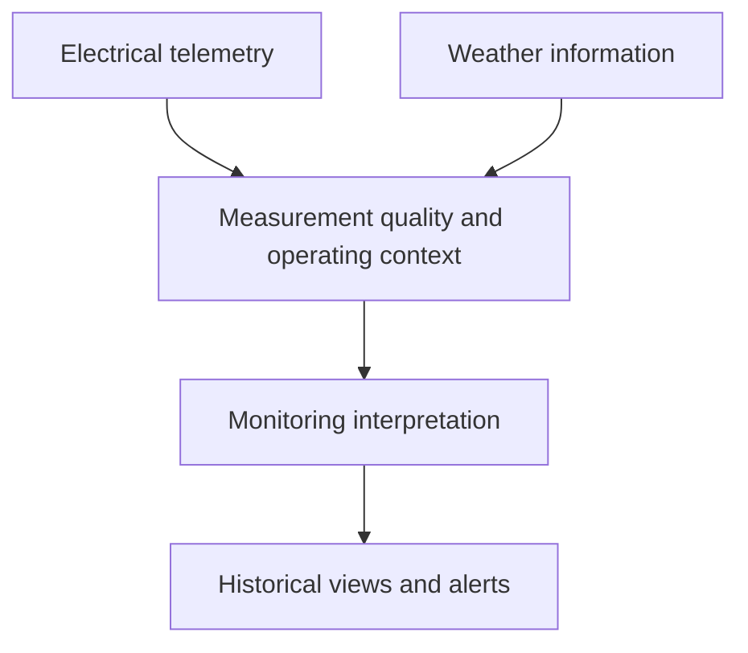

# Solar PV Monitoring System

**Electrical measurements · Renewable energy · Engineering data**

A privately developed monitoring prototype that combines MPPT telemetry and weather context to support interpretation of photovoltaic operating conditions.

This is a documentation-only showcase. Source code, hardware logs, datasets, and research-sensitive implementation remain private.

## Engineering problem

A low power reading does not have one meaning. It may reflect weather, night conditions, limited demand, or a loss of trustworthy telemetry. The monitoring workflow considers the quality and context of a reading before interpreting a possible performance issue.

## High-level approach

The private implementation includes serial ingestion, stored readings, weather integration, operating-state logic, an application dashboard, and alert lifecycle handling.

## Technology

Node.js · Express · JavaScript · MongoDB · SerialPort · Browser dashboard

## Scope of results

This showcase describes the monitoring application. It does not claim a verified machine-learning accuracy score, calibrated instrument accuracy, or proven fault-diagnosis performance.

The related research work is outside the public scope until its publication and intellectual-property boundaries are confirmed.

## Engineering lessons

Measurement units, channel meaning, telemetry freshness, and operating context must be understood before comparing expected and measured output. Monitoring states are useful only when validated against the actual wiring, hardware, and test conditions.

## Publication boundary

No raw device readings, serial identifiers, private site data, datasets, model-training methods, unpublished paper content, or patent-sensitive implementation is included.

## Portfolio

[Engineering portfolio](https://github.com/Wwwa22) · [Electrical AI Knowledge System](https://github.com/Wwwa22/electrical-ai-knowledge-system) · [ATHIQ](https://github.com/Wwwa22/athiq-privacy-platform)

## Author

[Saeed Ali Asiri](https://www.linkedin.com/in/saeed-ali-asiri/)
