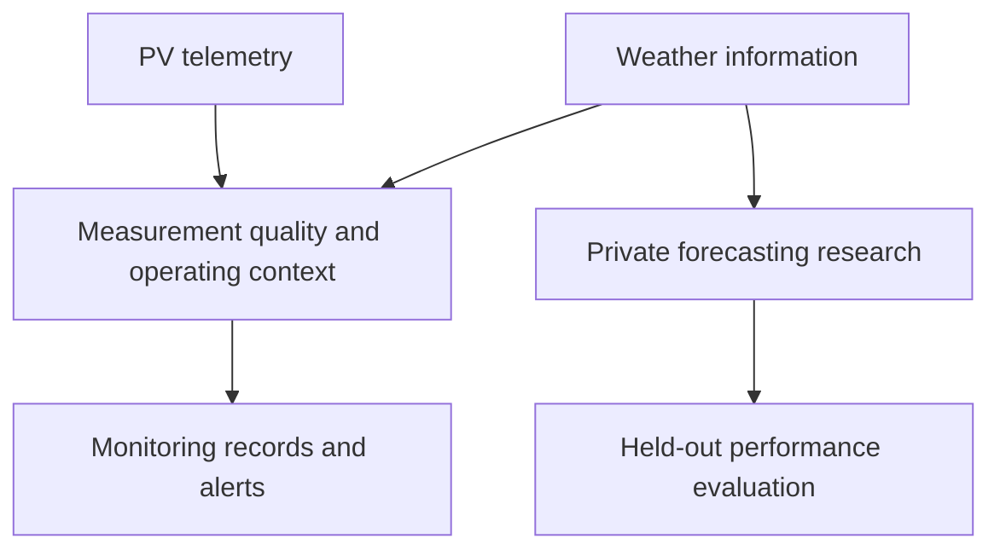

# Solar PV Monitoring & Forecasting

**Renewable Energy · Electrical Measurements · Weather-Aware Monitoring · AI-Enabled Engineering**

A PV engineering project with two complementary workstreams: a telemetry monitoring prototype and a forecasting research study. The work connects electrical measurements, weather context, software, and quantitative evaluation.

This is a documentation-only showcase. The implementation, research manuscripts, and underlying data remain private.

## Research results at a glance

The forecasting manuscript reports the following aggregate **source-time holdout** results for a prototype-scale dataset:

| Evaluated approach | MAE (W) | RMSE (W) | R² |
| --- | ---: | ---: | ---: |
| Physical-model baseline | 1.878 | 3.111 | 0.953 |
| Best evaluated hybrid forecast | **0.824** | **1.615** | **0.987** |

The reported evaluation uses **12,834 rows: 10,267 training and 2,567 test rows**. The best evaluated hybrid reduced MAE by approximately **56.1%** and RMSE by **48.1%** relative to the baseline, calculated from the manuscript's rounded values.

These are **manuscript-reported results**, checked against the supplied tables; the benchmark has not been independently rerun for this showcase.

[Evaluation context and monitoring case](docs/research-results.md)

## Engineering problem

Forecasting asks what output to expect. Monitoring asks how to interpret the observed output. A low power reading may reflect weather, operating conditions, limited demand, or untrustworthy telemetry; it does not establish a fault on its own.

## High-level architecture

The diagram summarizes the two workstreams. It does not assert that the evaluated research model is deployed in the monitoring application. Forecasting combines physical modelling and machine learning at a high level; model construction and implementation details are withheld.

The monitoring implementation includes serial ingestion, weather context, stored readings, operating-state logic, a dashboard, and alert lifecycle handling.

## Monitoring evidence

A second manuscript reports a prototype high-alert case with **20.52 W expected power, 0.00 W live power, and 40% cloud cover**. It illustrates an inspection-priority alert, not a validated diagnosis of obstruction or an electrical fault. A single case does not establish detection accuracy or false-alarm performance.

## Technology

**Monitoring application:** Node.js · Express · JavaScript · MongoDB · SerialPort · Browser dashboard

**Research scope:** physical PV modelling · machine learning · holdout evaluation

## Scope and limitations

- Results apply to the evaluated prototype and its reported split, not grid-scale or cross-site performance.
- The forecasting manuscript targets seven-day forecasting but reports aggregate holdout scores; these are not separate verified scores for each forecast lead time.
- Measurement calibration, fault diagnosis, live research-model integration, and production availability are not established by these manuscripts.
- The supplied manuscripts support the reported findings; conference acceptance, publication, peer review, and patent grant are not claimed.

## Publication boundary

Only approved high-level architecture, aggregate results, and evaluation context are presented. No PDFs, copied paper figures, datasets, raw logs, device/site identifiers, source code, feature recipes, equations, model settings, alert decision rules, or patent-sensitive implementation are published.

## Portfolio

[Engineering portfolio](https://github.com/Wwwa22) · [Electrical AI Knowledge System](https://github.com/Wwwa22/electrical-ai-knowledge-system) · [ATHIQ](https://github.com/Wwwa22/athiq-privacy-platform)

## Author

[Saeed Ali Asiri](https://www.linkedin.com/in/saeed-ali-asiri/)
