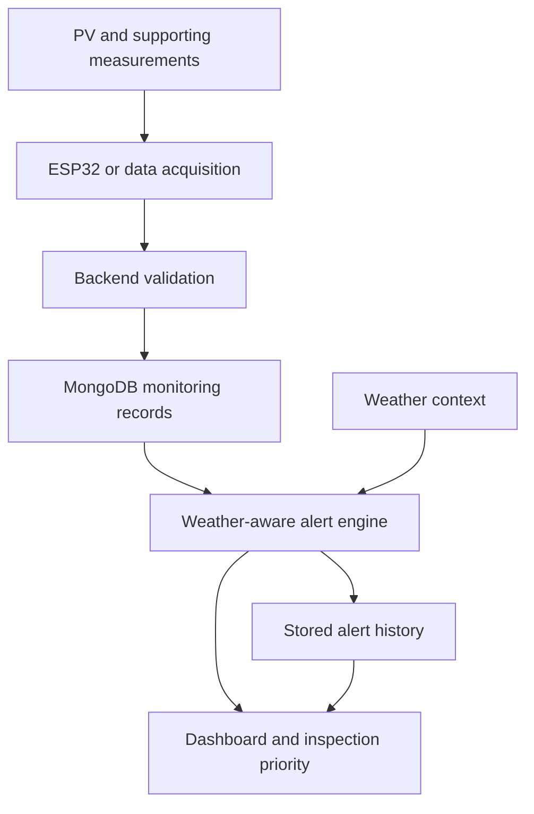
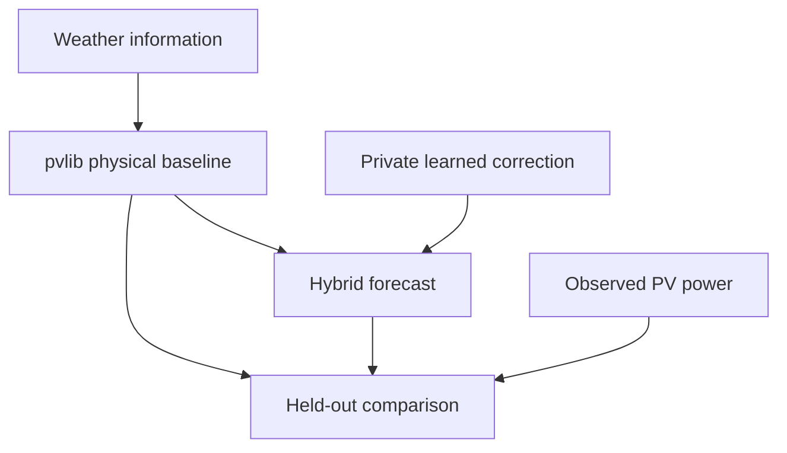

# Engineering architecture and evidence

This page describes the high-level system presented in the two author-provided AUPEC 2026 manuscripts. It is a research architecture, not a deployment or implementation certification.

## Monitoring, sensing, and telemetry

The monitoring manuscript describes PV and supporting measurements passing through an **ESP32 or data-acquisition layer** to a backend API. It does not establish a specific board, sensor part number, firmware release, wiring arrangement, transport protocol, or calibrated measurement accuracy.

| Layer | Manuscript-supported role |
| --- | --- |
| PV and supporting measurements | PV power and voltage, battery voltage, current, and temperature provide generation and operating context |
| Acquisition | ESP32 or a data-acquisition layer forwards measurements |
| Backend API | Validates incoming records and stores monitoring data |
| MongoDB | Retains monitoring records and recent alert history |
| Weather context | Cloud cover supports interpretation of generation deviations |
| Alert engine | Compares measured power with baseline or predicted power and assigns a severity |
| Dashboard | Presents current status, severity, alert snapshots, and recent history |

Cloud cover is weather context; the manuscript does not establish that a local sensor directly measures it. Operating and freshness flags support interpretation of data and system state.

Arrows show the manuscript's logical flow, not verified network topology, collection schemas, or service boundaries.

## Monitoring and alerting workflow

The manuscript describes incoming measurement validation, storage, comparison of observed and expected output, weather-aware severity assignment, and review through the dashboard and alert history. The public summary deliberately omits decision rules and operating thresholds.

An alert is an **inspection trigger**. Cloud information alone cannot establish soiling, obstruction, sensor failure, or an electrical fault. Automatic notification delivery and production deployment are not established.

## Physical modelling and machine learning

The forecasting manuscript uses **pvlib** as a physical PV power baseline driven by weather information. A learned correction produces a hybrid forecast, which is compared with the physical baseline on held-out observations.

This diagram exposes only component roles and evaluation relationships. Training recipes, features, equations, model settings, and model artifacts remain private. It does not assert that this research model powers the monitoring dashboard.

## Evaluation methodology

The forecasting manuscript describes a **source-time holdout**: 10,267 training rows and 2,567 test rows from 12,834 evaluated records. It compares a physical baseline and hybrid forecasts using MAE and RMSE in watts and R².

MAE summarizes absolute error; RMSE is more sensitive to large errors; R² describes regression fit. The manuscript describes the holdout as reducing optimistic results from random mixing of related time samples. The available evidence does not independently establish leakage-free preprocessing, exact split boundaries, or fully out-of-sample model selection.

The published aggregate values and their limits are documented in [research results](research-results.md). They are not horizon-by-horizon seven-day scores or a multi-site benchmark.

## Evidence boundaries across sources

| Evidence source | What it supports | What it does not establish |
| --- | --- | --- |
| Forecasting manuscript | pvlib + ML research architecture and reported holdout metrics | Reproduced benchmark or deployed forecasting service |
| Monitoring manuscript | Sensing/API/MongoDB/alert/dashboard architecture and one reported alert case | Calibrated sensors, diagnostic accuracy, or production readiness |
| Separately reviewed private monitoring code | Node.js/Express, MongoDB, serial ingestion, dashboard, and alert handling in that reviewed snapshot | Equivalence to the forecasting experiment or the complete research implementation |

The complete research implementation has not been audited for this showcase. That is an optional opportunity for deeper verification, not a prerequisite for presenting these manuscript-backed findings.

## Research authorship and individual contribution

Both supplied manuscripts list **Saeed Ali Asiri as the sole named author**. They document research on physical PV modelling, hybrid forecast evaluation, and weather-aware monitoring.

This establishes manuscript authorship. It does not independently assign every hardware, firmware, data-collection, or software task to one person. More detailed individual implementation claims can be added when supported by project records or a documented contribution statement.

## Safe visual evidence

The showcase already includes original high-level diagrams and an [aggregate evaluation chart](../assets/holdout-error-comparison.svg), redrawn from the manuscript's numerical table rather than copied from its figures.

The strongest optional additions are a sanitized real dashboard screenshot and a reviewed prototype photograph. They should remove identifiers, account details, addresses, endpoints, raw records, and sensitive hardware detail. A simulated display must be labelled synthetic and must not be presented as an actual run.

[Showcase](../README.md) · [Research results](research-results.md)
